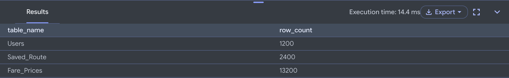
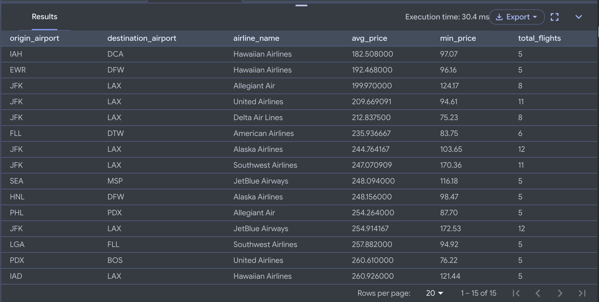
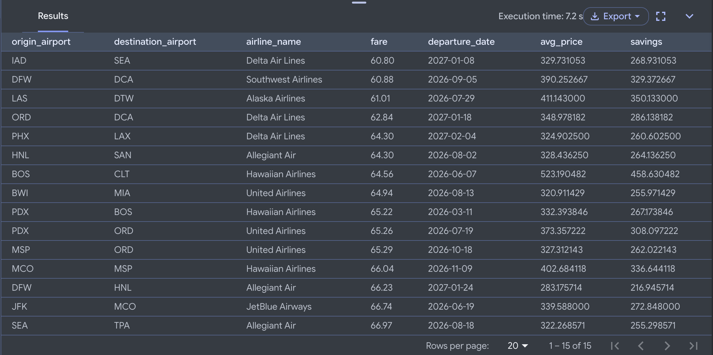
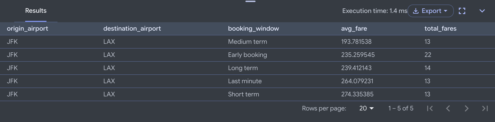
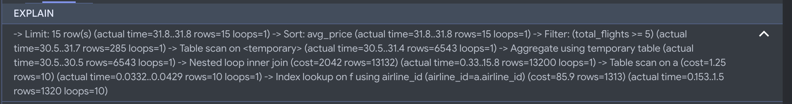
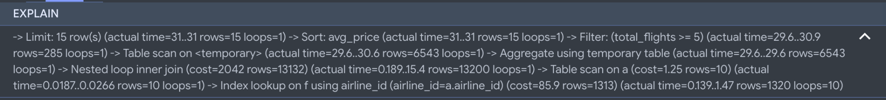
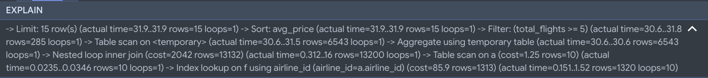
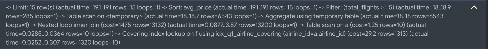

# FareWise — Database Design

## Part 1: Database Implementation

### 1. Database Schema
Our relational database consists of six tables : 
Airports:
```sql
CREATE TABLE Airports
(
  airport_code varchar(10) NOT NULL,
  aiport_name varchar(255) DEFAULT NULL,
  city varchar(255) DEFAULT NULL,
  country varchar(100) DEFAULT NULL,
  PRIMARY KEY (airport_code)
  );
```
Airlines:

```sql
CREATE TABLE Airlines
(
  airline_id int NOT NULL,
  airline_code varchar(10) DEFAULT NULL,
  airline_name varchar(255) DEFAULT NULL,
  PRIMARY KEY (airline_id)
);
```
Booking_Window:

```sql 
CREATE TABLE Booking_Window
(
  window_id int NOT NULL,
  label varchar(100) DEFAULT NULL,
  min_days int DEFAULT NULL,
  max_days int DEFAULT NULL,
  PRIMARY KEY (window_id)
);
```
Users: 
```sql 
CREATE TABLE Users (
  user_id int NOT NULL,
  username varchar(255) DEFAULT NULL,
  email varchar(255) DEFAULT NULL,
  password_hash varchar(255) DEFAULT NULL,
  airport_home varchar(10) NOT NULL,
  PRIMARY KEY (user_id),
  KEY airport_home (airport_home),
  FOREIGN KEY (airport_home) REFERENCES Airports(airport_code)
);
```
Saved_Route: 

```sql
CREATE TABLE Saved_Route (
    route_id INT NOT NULL,
    departure_day_filter VARCHAR(100) DEFAULT NULL,
    stop_type VARCHAR(50) DEFAULT NULL,
    target_price DECIMAL(10,2) DEFAULT NULL,
    note VARCHAR(255) DEFAULT NULL,
    created_at DATETIME DEFAULT NULL,
    is_archived TINYINT(1) DEFAULT NULL,
    user_id INT NOT NULL,
    origin_airport VARCHAR(10) NOT NULL,
    destination_airport VARCHAR(10) NOT NULL,
    airline_id INT DEFAULT NULL,
    window_id INT DEFAULT NULL,
    PRIMARY KEY (route_id),
    KEY user_id (user_id),
    KEY origin_airport (origin_airport),
    KEY destination_airport (destination_airport),
    KEY airline_id (airline_id),
    KEY window_id (window_id),
    FOREIGN KEY (user_id) REFERENCES Users(user_id),
    FOREIGN KEY (origin_airport) REFERENCES Airports(airport_code),
    FOREIGN KEY (destination_airport) REFERENCES Airports(airport_code),
    FOREIGN KEY (airline_id) REFERENCES Airlines(airline_id),
    FOREIGN KEY (window_id) REFERENCES Booking_Window(window_id)
);
```
Fare_Prices:
```sql
CREATE TABLE Fare_Prices (
    fare_id INT NOT NULL,
    origin_airport VARCHAR(10) NOT NULL,
    destination_airport VARCHAR(10) NOT NULL,
    airline_id INT NOT NULL,
    search_date DATE DEFAULT NULL,
    departure_date DATE DEFAULT NULL,
    fare DECIMAL(10,2) DEFAULT NULL,
    num_stops INT DEFAULT NULL,
    duration_min INT DEFAULT NULL,
    PRIMARY KEY (fare_id),
    KEY destination_airport (destination_airport),
    KEY origin_airport (origin_airport),
    KEY airline_id (airline_id),
    FOREIGN KEY (origin_airport) REFERENCES Airports(airport_code),
    FOREIGN KEY (destination_airport) REFERENCES Airports(airport_code),
    FOREIGN KEY (airline_id) REFERENCES Airlines(airline_id)
);
```
### 2. Data Population
We populated FareWise database with synthetic data to simulate users, saved flight routes, and airlines far observations.
To verify that at least three tables have at least 1000 rows we provided a screenshot of the row counts for Users, Saved_Route, and Fare_Prices.


### 3. Advanced SQL Queries
#### Query 1: Airline Fare Comparison
This query compares flight prices across differnt airlines and routes by calucalting the average fare, minimum fare, and total number of fare observations. We only included observations with flight paths that had more than 5 observations. 

```sql
select f.origin_airport, f.destination_airport, a.airline_name, AVG(fare) as avg_price, MIN(fare) as min_price, COUNT(*) as total_flights
from Fare_Prices f
join Airlines a on a.airline_id = f.airline_id
group by f.origin_airport, f.destination_airport, a.airline_id, a.airline_name
having total_flights >= 5
order by avg_price asc
limit 15; 
```

#### Query 2: Competing Airline Fare Comparison
This query identifies fares that are cheaper than the average flgith offered by every competing airline on the same route. It also calculates overall average fare for that route and the potential savings that come with choosing that specific flight and route. 

```sql
select f.origin_airport, f.destination_airport, a.airline_name, f.fare, f.departure_date, 
(
    select AVG(f2.fare)
    from Fare_Prices f2
    where f2.origin_airport = f.origin_airport and f2.destination_airport = f.destination_airport
) as avg_price,
(
    select AVG(f3.fare)
    from Fare_Prices f3
    where f3.origin_airport = f.origin_airport
    and f3.destination_airport = f.destination_airport
) - f.fare AS savings
from Fare_Prices f
join Airlines a on f.airline_id = a.airline_id
where f.fare < ALL (
    select AVG(f2.fare)
    from Fare_Prices f2
    where f2.origin_airport = f.origin_airport
    and f2.destination_airport = f.destination_airport
    and f2.airline_id != f.airline_id
    group by f2.airline_id
)
order by f.fare asc
limit 15; 
```

#### Query 3: Booking Window Analysis
This query compares average prices across diffrent booking windows for a specific route. In this example, we used JFK and LAX but can be changed for user preference in filter selection. It calculates the average fare and toal number of fare observation for each booking window to help determine which window period offers the best average price. 

```sql
select
    f.origin_airport,
    f.destination_airport,
    b.label as booking_window,
    AVG(f.fare) as avg_fare,
    COUNT(*) as total_fares
from Fare_Prices f
join Booking_Window b on DATEDIFF(f.departure_date, f.search_date) between b.min_days and b.max_days
where f.origin_airport = 'JFK' and f.destination_airport = 'LAX'
group by
    f.origin_airport,
    f.destination_airport,
    b.window_id,
    b.label
having count(*) >= 5
order by avg_fare asc
limit 15;
```


Query 3 only retuens five rows beacuse our database defines five booking window categoires. Since the query filters for only a single route and each booking window group classified as, Medium, Early, Long term, Last minute, Short term, only have the best prices assiocited with that window. 

## Part 2: Indexing Analysis
### Query 1: Indexing Experiments
We tested three composite indexes on Fare_Prices to improve the JOIN and GROUP BY operations. Before adding the experimental indexes the estimated nested loop join cost was 2042, with MySQL using the exisiting airline_id index. For Index Design 1 we created a composite key on Fare_Price(origin_airport, destination_airport) to test whether organizing fare records by route would improve query performance. The estimated joint cost remained at 2042, showing no improvement after adding this index. The ‘EXPLAIN ANALYZE’ output showed that the MySQL continued using the existing ‘airline_id’ index instead of the new composite index. This probably happened because the query processes fares across all routes rather than specifically filtering for a specific origin and destination. For Index Design 2 we created a composite index on ‘Fare_Prices(origin_airport, destination_airport, airline_id)’ for the second indexing experiment. We added ‘airline_id’ because it is used in both the JOIN and GROUP BY clauses, trying to see if including it would reduce the cost of grouping fares by route and airline. However, after running ‘EXPLAIN ANALYZE’, the estimated nested-loop join cost remained 2042, the same as both the baseline and the Index Design 1. This once again shows no improvement in the estimated join cost. For the third indexing experiment, we created a composite index on Fare_Prices(airline_id, origin_airport, destination_airport, fare). Unlike the other previous two designs, this index places airline_id first to support the JOIN condition which includes all the Fare_Prices attributes required by the query. After adding the index, the estimated nested-loop join cost decreased from 2042 to 1475, approximately a 27.8% reduction. This shows that MySQL used idx_q1_airline_covering through an index lookup. This improvement occurred because MySQL could find records by airline and retrieve the required route and fare information directly from the index without accessing the full table rows.

| Configuration | Join Cost | Improvement |
|---|---:|---:|
| Baseline | 2042 | — |
| Index Design 1 | 2042 | 0% |
| Index Design 2 | 2042 | 0% |
| Index Design 3 | 1475 | 27.8% |

Baseline Results: 

idx_q1_route(Index 1):

idx_q1_route_airline(Index 2):

idx_q1_airline_covering(Index 3):
idx_q1_route_airline(Index 2):



### Query 2: Indexing Experiments

### Query 3: Indexing Experiments

### Final Indexing Design